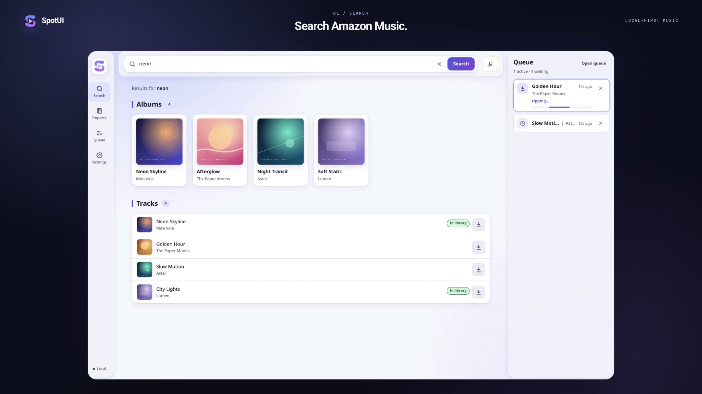
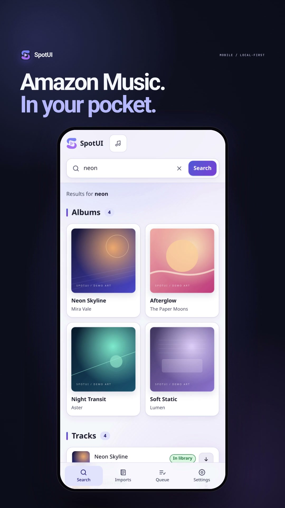

<p align="center">
  
</p>

<h1 align="center">SpotUI</h1>

<p align="center">
  <strong>Search, choose, and download from Amazon Music — locally.</strong><br />
  A private FastAPI + React interface for a durable, local download queue.
</p>

<p align="center">
  <a href="#features">Features</a> ·
  <a href="#launch-videos">Videos</a> ·
  <a href="#quick-start">Quick start</a> ·
  <a href="#phone-access">Phone access</a> ·
  <a href="#configuration">Configuration</a> ·
  <a href="#api">API</a> ·
  <a href="#development">Development</a>
</p>

<p align="center">
  
  
  
  
  
  
</p>

SpotUI is a local web app for finding music on Amazon Music, choosing the exact
release, and downloading it through a managed `lucidadl` environment. Search and
inspect albums or playlists, queue tracks, and follow progress from the desktop
or a paired phone. It also imports public Spotify playlists, indexes your
existing library without changing it, and keeps queue state in SQLite across
restarts.

No cloud backend, hosted account, or Spotify login is involved.

## Legal notice

> [!WARNING]
> **Use at your own risk.** SpotUI is an independent, local interface and does
> not provide, host, or distribute music. It is not affiliated with Amazon
> Music, Spotify, or lucidadl. Downloading or converting content may be
> restricted by copyright law, service terms, or regional rules. Use SpotUI
> only with content you have the legal right to access and download, and comply
> with applicable laws and agreements. To the extent permitted by law, the
> project authors accept no responsibility for misuse. This notice is not legal
> advice.

> [!NOTE]
> **SpotUI v0.1.0 is released.** Download the wheel, installer, and checksums
> from the [latest release](https://github.com/runtime-terror404/spotui/releases/latest),
> or run from source using the quick start below.

## Features

- **Amazon Music search** through Playwright, with album, track, artist, and
  playlist results.
- **Exact release selection** with artwork and track lists for albums,
  editorial playlists, and public community playlists.
- **Durable queue** that persists jobs, runs one download at a time, and
  supports cancellation, retry, and restart recovery.
- **Spotify imports** for public albums and playlists, with progressive matching
  and explicit review before anything is queued.
- **Read-only library index** across multiple music roots, using Mutagen tags
  and Amazon identity detection.
- **Now Playing shortcut** that reads the current MPRIS track only when clicked.
- **Trusted LAN access** with a desktop-only pairing code, hashed device
  credentials, CSRF protection, and subnet enforcement.
- **Useful settings** for System/Light/Dark themes, download location, library
  status, application paths, and library counts.
- **Safe operations**: verified database backups, migrations, systemd helpers,
  a data-preserving uninstaller, and a repeat-safe legacy queue import.

## Launch videos

<p align="center">
  <a href="asset/spotui-desktop-launch.mp4">
    
  </a>
</p>

<p align="center"><strong>Desktop</strong> · 19.4 seconds</p>

<p align="center">
  <a href="asset/spotui-mobile-launch.mp4">
    
  </a>
</p>

<p align="center"><strong>Mobile</strong> · 19.8 seconds</p>

Music: Sascha Ende, [ende.app](https://ende.app/en) (CC BY 4.0). Sound effects:
Kenney.nl (CC0). Demo catalog titles and artwork are fictional. Full media
credits: [`asset/spotui-launch-credits.txt`](asset/spotui-launch-credits.txt).

## Requirements

- 64-bit Linux — Ubuntu 22.04 LTS or newer, or rolling Arch Linux. x86_64 is
  tested.
- [`uv`](https://docs.astral.sh/uv/) for SpotUI's isolated Python environment.
- Node.js and npm for source frontend builds only.
- Internet access for Amazon Music, Spotify imports, and dependency installs.
- Optional: `playerctl` and an MPRIS-compatible player for Now Playing.

Playwright Chromium and `lucidadl` are installed explicitly with
`spotui deps install`. SpotUI never starts by installing or updating anything,
and it never modifies system Python.

## Quick start

### From source

```bash
git clone https://github.com/runtime-terror404/spotui.git
cd spotui
uv sync --all-groups
(cd frontend && npm ci && npm run build)
uv run spotui db upgrade
uv run spotui deps install
uv run spotui deps check
uv run spotui serve
```

Open <http://127.0.0.1:8765/>.

Album and editorial-playlist support may require the downloader's one-time
Cloudflare setup. Run `spotui deps check` to find the managed executable, then
follow [`docs/installation.md`](docs/installation.md) for the setup command and
platform libraries.

For frontend development, keep the backend running on port 8765 and start Vite
in another terminal:

```bash
cd frontend
npm run dev
```

Vite proxies `/api` to the backend.

### From a release

```bash
VERSION=0.1.0
BASE="https://github.com/runtime-terror404/spotui/releases/download/v${VERSION}"
curl -fLO "$BASE/install.sh"
curl -fLO "$BASE/uninstall.sh"
curl -fLO "$BASE/SHA256SUMS"
sha256sum --check --ignore-missing SHA256SUMS
chmod +x install.sh uninstall.sh
./install.sh --version "$VERSION"
```

The installer creates the isolated environment, registers
`~/.local/bin/spotui`, and applies migrations. It is re-runnable, does not
install the downloader, and does not start the server. Finish with:

```bash
spotui deps install
spotui deps check
spotui serve
```

Optional systemd user service:

```bash
spotui service install
spotui service enable
spotui service status
```

## How it works

```text
React 19 + TypeScript
          │ REST + SSE
          ▼
    FastAPI /api/v1
          │
  ┌───────┼─────────────────────────────┐
  ▼       ▼                             ▼
SQLite   Amazon Music / Spotify     lucidadl
queue,   providers                  managed downloads
library,
devices
```

SQLite and the REST API are authoritative. One worker owns exactly one
`lucidadl` process at a time. Imports report progress through SSE; queue and
library updates currently use polling.

## Usage

1. **Search** for a track, album, artist, or playlist.
2. **Open a result** to inspect its artwork and track list.
3. **Add tracks** individually or in bulk.
4. **Watch the queue** for phase and progress updates.
5. **Review failures** under Needs attention and retry or dismiss them.

Cancelled waiting jobs leave the queue immediately and do not enter history.
Failed or interrupted jobs can be retried or dismissed with the X action.
History shows the newest 50 completed downloads; the Completed count still
covers every stored job.

To import music from Spotify, open **Imports**, paste a public album or playlist
URL, review the Amazon matches, and enqueue only the tracks you select. SpotUI
never auto-selects a match.

## Phone access

LAN access is disabled until `server.trusted_subnet` is set in `config.toml` and
an active local IPv4 interface matches that CIDR. SpotUI binds loopback plus
that exact interface; it never binds `0.0.0.0`.

1. Configure your home subnet and restart SpotUI.
2. Run `spotui status` to confirm the LAN URL.
3. Open **Settings** on the desktop to see the URL and pairing code.
4. Open the LAN URL on your phone and enter the six-digit code.

Pairing codes change on restart. Paired devices survive restarts until revoked
from desktop Settings, and pairing attempts are rate-limited.

> [!WARNING]
> LAN traffic is plain HTTP and is **not encrypted**. Never expose SpotUI to the
> public internet, forward its port from your router, or use it on untrusted
> Wi-Fi. A DHCP reservation for the server's LAN address is recommended.

## Configuration

All application-owned files live under one root, by default
`~/.local/share/spotui/`. Configuration is read from `<root>/config.toml`. Set
`SPOTUI_HOME` to an absolute directory to move the entire root, including the
database, logs, cache, lock, backups, and managed environments.

Precedence is: defaults → config file → `SPOTUI_*` environment variables → CLI
flags. Invalid settings fail startup with an actionable message.

```toml
[server]
port = 8765
# Set this only to your home IPv4 CIDR. Find it with `ip -4 addr` / `ip route`.
# trusted_subnet = "192.168.1.0/24"
shutdown_grace_seconds = 5.0

[logging]
level = "INFO"
max_bytes = 5242880
backup_count = 5

[queue]
cancel_grace_seconds = 5.0
shutdown_grace_seconds = 5.0
job_timeout_seconds = 900.0

[library]
# Multiple read-only roots are supported. Existing files are never modified.
# roots = ["/mnt/Shared/Music", "/mnt/Archive/Music"]
refresh_seconds = 3600  # 0 disables periodic refresh
scan_on_startup = true

[matching]
concurrency = 3  # bounded Amazon searches per active import, range 1–5
```

Common environment overrides include `SPOTUI_HOME`, `SPOTUI_CONFIG`,
`SPOTUI_PORT`, `SPOTUI_TRUSTED_SUBNET`, and `SPOTUI_LIBRARY_ROOTS` (OS path
separator-delimited absolute directories).

Library roots are configured explicitly; SpotUI does not infer them from
`lucidadl`. In-library badges and batch skipping stay disabled until a root is
configured.

### Data locations

| Data | Default under the root |
|---|---|
| Configuration | `config.toml` |
| Database | `spotui.sqlite3` (plus `-wal`/`-shm`) |
| Backups | `backups/` |
| Logs | `logs/spotui.log` |
| Cache | `cache/` |
| Lock | `run/server-<root-hash>.lock` |
| Managed environments | `envs/{spotui,lucidadl}/` |
| Legacy queue | `queue.json` — read-only |

The PATH launcher (`~/.local/bin/spotui`) and optional systemd unit
(`~/.config/systemd/user/spotui.service`) remain outside the root because the
OS requires fixed locations. Downloaded media stays at the destination
configured in `lucidadl`; SpotUI never moves or modifies existing media.

## Maintenance

```bash
spotui status            # paths, URLs, lock, and health state
spotui db current        # applied migration revision
spotui db backup         # verified backup before maintenance
spotui deps check        # browser and managed lucidadl status
spotui migrate-legacy --dry-run
```

Import an old JSON queue only after a dry run. The source file is never
modified, repeat runs do not duplicate jobs, and active legacy jobs become
`interrupted`.

Updates are manual: stop the service, rerun `install.sh` with the new version,
and use `spotui deps upgrade` only when release notes require it. Normal
uninstalls preserve configuration, database, logs, downloader environment,
library roots, and music. See [`docs/installation.md`](docs/installation.md) for
updates, backups, rollback, migration details, and full uninstall.

## API

The API lives under `/api/v1`; OpenAPI documentation is available at `/docs` in
development.

| Area | Primary endpoints |
|---|---|
| Health and system | `GET /health`, `GET /system/info` |
| Catalog | `GET /search`, `GET /entities/detail`, `GET /now-playing` |
| Queue | `GET /queue`, `POST /queue/jobs`, `POST /queue/batch` |
| Imports | `GET/POST /imports`, `GET /imports/{id}/events`, matching actions, `POST /imports/{id}/enqueue` |
| Library | `GET /library`, `POST /library/scan` |
| Access | `GET /auth/status`, `POST /auth/pair`, `GET/DELETE /devices` |

State-changing requests require a double-submit CSRF token. The app bootstrap
primes the `spotui_csrf` cookie; scripts must retain it and send it in
`X-CSRF-Token`. LAN requests also require the persistent `spotui_device` cookie.
API errors use RFC 9457 `application/problem+json` with stable `code` and
`request_id` values.

## Development

```bash
uv sync --all-groups
uv run spotui db upgrade
uv run spotui serve

# Second terminal
(cd frontend && npm run dev)

# Checks
uv run pytest
uv run ruff check .
uv lock --check
(cd frontend && npm test && npm run typecheck && npm run build)
```

The production frontend build is written to `src/spotui/web/dist/` and bundled
into the wheel and source distribution. Python and frontend versions are checked
against a single Python source of truth.

## Known limitations

- Linux is the only supported platform; x86_64 is tested.
- LAN mode is plain HTTP and restricted to a trusted subnet.
- Queue and library updates use polling; imports use SSE.
- Imported Spotify tracks require explicit Amazon matching.

## Documentation

- [Installation and maintenance](docs/installation.md)
- [Release process](docs/release-process.md)
- [Baseline audit and verification](docs/baseline-audit.md)
