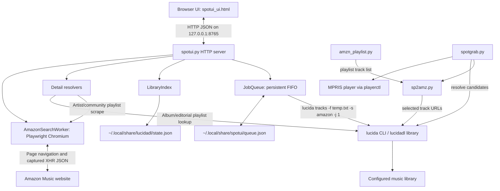
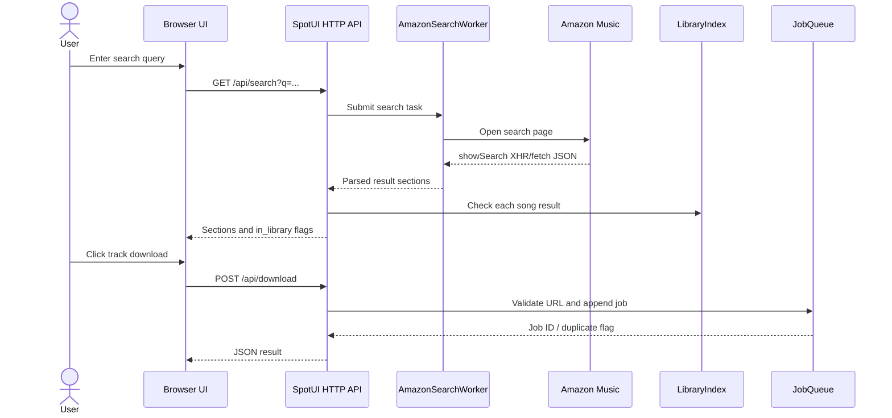
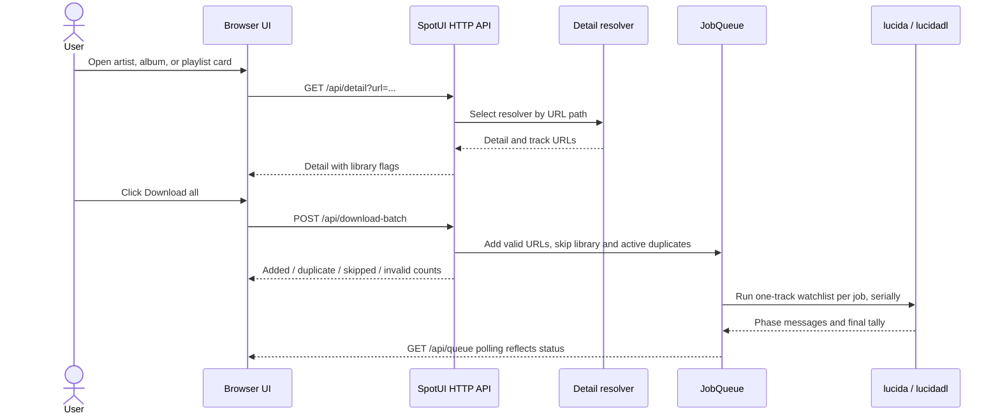

# SpotUI Architecture

## 1. Purpose and scope

This document describes the architecture of the files in this archive. It is based on the Python source, the HTML/CSS/JavaScript UI, and the two supplied README files.

SpotUI is a local music-search and download queue application. It searches Amazon Music through a headless browser, presents the search results in a browser UI, and sends selected Amazon track URLs to `lucidadl` for downloading. The companion command-line tools support playlist extraction, interactive source-to-Amazon matching, and grabbing the track currently playing in an MPRIS-compatible music player.

The archive does not contain the `lucidadl` implementation, systemd unit file, command wrappers, dependency lock file, or automated tests. Those parts are described only at the integration boundary where the supplied files provide evidence.

## 2. System overview

The project has four Python entry points and one browser interface:

- `spotui.py`: local HTTP server, Amazon search browser worker, library index, detail resolvers, persistent download queue, and `open` / `serve` commands.
- `spotui_ui.html`: single-page UI with search, result cards, detail pages, library badges, queue controls, and periodic queue polling.
- `spotgrab.py`: CLI that reads the current MPRIS track, resolves a candidate on Amazon, and invokes `lucida tracks` for one selected URL.
- `sp2amz.py`: interactive playlist-to-Amazon converter. It searches candidates, lets the user choose the exact version, and writes exact Amazon URLs.
- `amzn_playlist.py`: source playlist parsers and Amazon Music DOM scraper. It writes either `Artist - Title` lines or Amazon page URLs.

All download paths ultimately delegate download, metadata, organization, de-duplication, retries, and optional transcoding to the external `lucidadl` package and its `lucida` command.

The diagram shows logical dependencies. `sp2amz.py` imports parsing functions from `amzn_playlist.py`, while `spotgrab.py` imports `AmazonFallbackSearch` from `sp2amz.py` only when fallback search is needed. `spotui.py` imports player and notification helpers from `spotgrab.py`.

## 3. Repository inventory

| File | Responsibility | Runtime role |
|---|---|---|
| `spotui.py` | HTTP API, Amazon browser automation, library matching, queue worker, process launcher | Main local service and launcher |
| `spotui_ui.html` | Markup, CSS, browser-side JavaScript | Served directly by `spotui.py` at `/` |
| `spotgrab.py` | MPRIS lookup, Amazon resolution, download invocation, notifications | CLI and helper module for SpotUI |
| `sp2amz.py` | Interactive candidate search and selection | CLI |
| `amzn_playlist.py` | Spotify, YouTube, YouTube Music parser functions and Amazon DOM playlist scraper | CLI and parser module imported by `sp2amz.py` |
| `README.md` | Project overview, installation, workflows, tool references, deployment notes | Documentation |
| `README (1).md` | Documentation for the external `lucidadl` downloader dependency | Reference documentation, not SpotUI implementation |
| `__pycache__/*.pyc` | Compiled Python bytecode cache for the four Python files | Generated artifacts, not source of truth |

The bytecode files are named for CPython 3.14, while the source syntax check in this inspection used Python 3.13.5. The architecture below uses the supplied `.py` source as the authoritative implementation.

## 4. Runtime topology and startup

### 4.1 Local service

`spotui.py serve` starts the service. The service binds to `127.0.0.1:8765` through `ThreadingHTTPServer`. It does not listen on all network interfaces.

During startup, `serve()`:

1. Creates and starts one `AmazonSearchWorker` thread.
2. Creates a `JobQueue`, which loads persisted jobs and starts the queue worker and queue-pruner threads.
3. Creates a `LibraryIndex`.
4. Assigns these shared objects to class attributes on the HTTP `Handler`.
5. Starts the HTTP server loop.

Each HTTP request is handled by a server thread. Browser automation requests are passed to the single search worker because Playwright's synchronous objects must stay on the thread that created them. Download queue operations use a lock around shared job data.

The searcher's Chromium instance is created lazily on its first browser task and is reused for later search/detail requests. The source sends a stop sentinel when the server loop exits, but the worker does not explicitly close the Playwright browser or Playwright object when it receives that sentinel.

### 4.2 `spotui open`

The default command is `open`. It:

1. Runs `systemctl --user start spotui.service` and suppresses that command's output.
2. Polls `/api/health` for up to about ten seconds.
3. If the service does not respond, starts a detached `spotui.py serve` process as a fallback and polls again.
4. Sends a desktop notification and exits with status 1 if the health endpoint still does not respond.
5. Opens `http://127.0.0.1:8765/?now=1` with `xdg-open`.

The systemd unit file is not included in the archive. The README describes a user service and a KDE shortcut, but those deployment files are outside the source tree provided here.

### 4.3 Browser-side startup

The HTML file is served as-is from the directory containing `spotui.py`. There is no frontend build step or JavaScript framework. The browser script binds event handlers, polls the queue immediately, and then polls every 1.2 seconds. When the URL contains the `now` query parameter, it loads the current MPRIS track title and starts a search for that title.

## 5. Component architecture

### 5.1 `spotui.py`

This file is the service's central module. It contains URL helpers, library indexing, Amazon search/detail extraction, queue persistence, HTTP routing, and process startup.

#### URL and title helpers

- `asin_from_url(url)` extracts a ten-character ASIN from either `trackAsin=ASIN` or `/tracks/ASIN`.
- `is_track_url(url)` accepts an Amazon Music URL matching the source's regular expression and containing an ASIN.
- `_norm_title(text)` lowercases titles, removes square-bracketed and parenthesized phrases, replaces non-alphanumeric characters with spaces, and collapses whitespace.
- `_norm_text(text)` normalizes artist text to lowercase alphanumeric tokens.

These helpers are used for input checking and library matching. `is_track_url()` uses a regular expression rather than strict URL parsing and exact hostname validation, so its hostname check is looser than a dedicated allowlist.

#### `LibraryIndex`

`LibraryIndex` checks whether a track is already present in the local library. It reads `~/.local/share/lucidadl/state.json` and expects a `done` mapping from canonical source URLs to one or more output file paths.

Matching has two levels:

1. **ASIN match.** ASINs are extracted from completed-state keys. This is the primary match.
2. **Title and artist fallback.** For existing output files under an `Artists/<Artist>/<Album>/<Title>.<extension>` path, normalized title and artist tokens are indexed. A title match counts when the supplied artist is absent or at least one normalized artist token overlaps.

A state entry is ignored when none of its recorded output files still exists. The index refreshes lazily every ten seconds and protects refresh/read operations with a lock.

The implementation uses a fixed `STATE_FILE` under `~/.local/share/lucidadl`. It does not read the `LUCIDADL_HOME` override described in the dependency README. The title/artist fallback also assumes the organized `Artists` directory layout. It does not index flat output or other folder layouts.

#### `AmazonSearchWorker`

This daemon thread owns a synchronous Playwright Chromium browser and serializes browser work through a queue of callables and `Future` objects. The HTTP handler waits for the future result and returns its value or error.

The worker supports three public operations:

- `search(query)`: opens an Amazon Music search page and captures an XHR/fetch response whose URL contains `showSearch`.
- `artist_detail(url)`: captures a response whose URL contains `showCatalogArtist`, then recursively extracts track and album items.
- `user_playlist_detail(url)`: opens a community/user playlist and reads `music-image-row[primary-text]` rows from the rendered DOM while scrolling through a virtualized list.

Search results are cached by lowercased query for 600 seconds, but only non-empty parsed sections are cached. The response parser assumes a specific shape, `data.methods[0].template.widgets`, and recognizes the exact section headers `Artists`, `Albums`, `Songs`, `Playlists`, and `Community Playlists`. It classifies items from their deep links and de-duplicates each section by URL.

The browser extraction depends on Amazon's page behavior, internal request names, JSON structure, and DOM attributes. Those are implementation details of the website rather than a stable public API.

#### Detail resolution

The detail endpoint uses one of three code paths:

- **Artist:** `AmazonSearchWorker.artist_detail()` captures and recursively walks the artist page's internal JSON response. It extracts track and album cards.
- **Community/user playlist:** `AmazonSearchWorker.user_playlist_detail()` scrapes rendered playlist rows. It accumulates rows across scroll passes because Amazon virtualizes the list.
- **Album/editorial playlist:** `lucida_detail()` calls `lucida_page_data()`, which loads the saved Cloudflare clearance data, creates a `LucidaClient`, and calls `fetch_page_data()` from the external `lucidadl` package. Only a response whose metadata type is `album` or `playlist` is accepted. Track URLs come from the resolver and are intended to be canonical downloader URLs.

`enrich_library()` annotates each detail track with an `in_library` Boolean before returning it to the browser.

#### `JobQueue`

`JobQueue` implements a persistent FIFO queue with one worker. Each job stores an ID, title, artist, exact URL, status, message, output file, and integer timestamps.

The known statuses are:

- `queued`: accepted and waiting.
- `running`: the downloader process is working, including metadata fetch and ripping stages.
- `downloading`: the worker detected the downloader's stream-download phase.
- `done`: the track was saved or was already in the library.
- `failed`: the download did not meet the success criteria.
- `cancelled`: a queued job was cancelled before it started.

The downloader output parser also places phase messages such as `fetching metadata…`, `ripping…`, and `finalizing…` in the job's `message`; these are messages, not separate status values.

Queue behavior:

- Queue state lives at `~/.local/share/spotui/queue.json`.
- Writes use a temporary sibling file followed by `os.replace()`.
- A duplicate URL is rejected when an equivalent job is queued, running, or downloading.
- Cancellation works only for queued jobs.
- Retry works only for failed jobs, returning them to `queued`.
- On startup, persisted `running` and `downloading` jobs are changed to `queued` because the service assumes an interrupted job should run again.
- Successful jobs are removed from persisted and in-memory queue state about three seconds after completion.
- Failed and cancelled entries remain in the list.
- The JSON save method writes the last 300 jobs, but the in-memory list is not itself truncated to 300 entries.

The worker writes a single selected URL to a temporary text file and launches:

`lucida tracks -f <temporary-file> -s amazon -j 1 --hidden`

It consumes stdout and stderr together, maps downloader phase lines to queue status/message updates, and parses the `Done` tally. It treats `OK > 0` and `failed == 0` as success, and treats `OK == 0`, `skipped > 0`, and `failed == 0` as already present. A zero process exit code alone is not treated as sufficient evidence of success.

The command does not add `--to flac`. It relies on the downloader's `original` behavior for the selected source. The UI describes the workflow as Amazon-to-FLAC, but the archived SpotUI code does not explicitly force FLAC conversion.

#### HTTP handler and launcher

`Handler` exposes a small JSON API. Standard request access logging is suppressed. JSON responses include a content type and content length.

The body parser reads the supplied `Content-Length` and converts malformed or empty JSON to an empty object. There is no request-body size limit or authentication layer.

The service returns the UI file at `/` and handles API routes documented in Section 7. The handler is shared across server threads through class-level references to the search worker, queue, and library index.

### 5.2 `spotui_ui.html`

The frontend is a single HTML document with inline CSS and JavaScript.

UI regions:

- **Header and search:** text query, Search button, Now button, and current-track display.
- **Search results:** grouped Amazon sections. Song items render as rows with download buttons. Other item types render as cards that open detail views.
- **Detail view:** title/artwork, library count, track list, and a batch-download action. Artist details also show album cards.
- **Queue panel:** active/queued counts, job status text, and cancel/retry buttons.
- **Toast layer:** short success/error messages.

The JavaScript is organized around small DOM functions rather than framework components. `api()` wraps `fetch()` and raises on non-2xx responses. `doSearch()` requests `/api/search`. `openDetail()` requests `/api/detail`. `enqueueOne()` posts one exact URL, and `downloadAll()` posts a batch. `pollQueue()` retrieves `/api/queue` and reconciles rows through a map keyed by job ID, avoiding full queue DOM replacement on every poll.

The frontend records enqueued URLs in an in-memory `Set`. It adds URLs on an individual enqueue, a batch enqueue, and queue polling. It does not remove URLs from this set when a job becomes failed or cancelled. As a result, a corresponding track button may stay disabled until the page is reloaded even though the backend permits a retry or a new queue request.

The CSS defines a dark theme with amber accents, responsive two-column layout, result cards, queue states, and short animations. The page fetches display fonts from Google Fonts and loads artwork from the image URLs returned by Amazon. The application does not bundle those remote assets.

### 5.3 `spotgrab.py`

`spotgrab.py` is the single-track CLI and a shared helper module for SpotUI.

Key responsibilities:

- Detect an MPRIS player using `playerctl -l`. `SPOTGRAB_PLAYER` overrides detection. Otherwise it prefers a player name containing `spotify`, then `spotifast`, then `spot`, and falls back to the name `spotify`.
- Read status, title, artist, and track ID/URL from `playerctl`. It accepts `Playing` and `Paused` states.
- Send desktop notifications with `notify-send`. Notification errors are ignored.
- Resolve the track using `lucidadl` search and its query variants. The selected result is checked against `VARIANT_KWS`; if the title looks like a remix, cover, lofi, or other variant not present in the query, the code checks Amazon website ranking through `AmazonFallbackSearch` from `sp2amz.py`.
- Download through `lucida tracks` using a temporary one-line watchlist file. Optional `--to` and `--bitrate` flags are passed to the downloader.
- Support `--status` and `--dry-run`.

The resolver trusts the first exact title match from the fallback list, otherwise it takes the first website result. If fallback search returns no results, it uses the lucidadl candidate when one exists.

`LUCIDA_BIN` is resolved once at module import by `shutil.which("lucida")`, with `/home/divine/.local/bin/lucida` as a hard-coded fallback. This supports shortcuts with a limited `PATH`, but the fallback path is specific to the original environment.

The default download command does not pass `--to flac`; it relies on source format behavior. The success notification uses a FLAC label even when `--to` selects another output format, which makes the notification text less accurate for non-FLAC runs.

### 5.4 `sp2amz.py`

`sp2amz.py` converts a playlist or list of track queries into exact Amazon URLs with an interactive picker.

Input handling:

- `-f FILE`: read non-comment, non-empty query lines from a text file.
- Spotify link: use `spotify_tracks()` from `amzn_playlist.py`, then build `Artist - Title` search queries.
- YouTube or YouTube Music link: use `youtube_tracks()` and search by title only. This avoids long multi-artist strings from dominating the query.
- Other positional input: treat it as one search line.
- `--dry-run`: print the generated queries without starting the search client or prompting.

For each query, the tool walks query variants from `lucidadl.downloader._query_variants()` and searches the chosen service, defaulting to Amazon. It presents up to ten candidate tracks or albums. `Enter` selects the first result, a number selects a result, `s` skips, `q` exits, and `n` advances to the next search variant. It also supports configured service fallbacks from `lucidadl`.

If all lucidadl search variants return no candidates and Amazon is the selected service, `AmazonFallbackSearch` opens Amazon Music in asynchronous Playwright, captures the `showSearch` response, and offers up to ten website results.

Selected URLs are written to the configured output file, defaulting in source to `/mnt/Shared/Music/inputs/tracks.txt`. The file's parent directory is created if needed. The next step described in the CLI is running `lucida tracks -s amazon` from the music directory.

The implementation prints a message about one retry pass when no candidate is found, but the retry attempts to advance an already exhausted async generator. It does not repeat the search calls as the message suggests.

### 5.5 `amzn_playlist.py`

This module extracts track lists from source services.

#### Spotify parser

`spotify_tracks(url)` follows redirects, extracts the Spotify album or playlist ID, loads the public embed page, parses the `__NEXT_DATA__` JSON, recursively collects `trackList` arrays, and selects the longest array. It filters out non-track URIs, extracts title and the first artist from the subtitle, and de-duplicates title/artist pairs.

#### YouTube Music parser

`youtube_tracks(url)` detects YouTube Music pages, extracts a `/browse` payload from `initialData.push()` calls, decodes hex-escaped JSON, recursively finds `musicResponsiveListItemRenderer` objects, and uses flex-column text for the track title and artist.

#### Regular YouTube parser

For standard YouTube playlist/mix pages, `youtube_tracks()` parses the `ytInitialData` JSON, collects `playlistPanelVideoRenderer` entries, and removes text after the first pipe character from titles.

#### Amazon Music DOM scraper

`scrape(url, debug=False)` uses synchronous Playwright Chromium to open the URL. It waits for `music-image-row[primary-text]`, extracts title, artist, album, href, and row-order attributes, then scrolls repeatedly to accumulate rows from Amazon's virtualized playlist. It sorts by row order and returns the track tuples. `--debug` saves rendered HTML to `debug/page.html`.

The command-line `main()` currently routes Spotify URLs to `spotify_tracks()` and sends every other URL to the Amazon DOM scraper. Although `youtube_tracks()` is implemented and imported by `sp2amz.py`, `amzn_playlist.main()` does not dispatch YouTube URLs to it. Therefore, the README's statement that `amzn-playlist` automatically handles YouTube and YouTube Music links does not match the current CLI routing.

The source code's default output is `inputs/tracks.txt`, relative to the current working directory. The README also describes an installation with wrappers and a pinned music-directory output path, but those wrapper files are not in this archive.

## 6. Data flow

### 6.1 Search and select one track

### 6.2 Open an item and download many tracks

### 6.3 Current-track flow

`spotgrab` and the UI's Now button share `mpris_now_playing()` from `spotgrab.py`. The UI requests `/api/now`; the CLI calls the helper directly. The CLI uses both artist and title for resolver queries. The UI's automatic `/?now=1` path searches by title only, while the displayed chip includes artist and title.

## 7. HTTP API contract

The API is served from `http://127.0.0.1:8765`. JSON routes use the `Handler` class. Error responses generally use `{"error":"..."}`.

| Route | Method | Input | Success response | Main failure behavior |
|---|---|---|---|---|
| `/` | GET | None | Raw `spotui_ui.html` document | `500` if the HTML file is missing |
| `/api/health` | GET | None | `{"ok": true}` | No explicit application-level failure path |
| `/api/now` | GET | None | MPRIS metadata object, or JSON `null` when no usable track is playing | Player errors often collapse to no metadata |
| `/api/search?q=...` | GET | URL query parameter `q` | `{"sections": [...]}` | `400` for missing query, `502` for search/browser errors |
| `/api/detail?url=...` | GET | URL query parameter `url` | `{"detail": {...}}` | `400` unless the value starts with `https://music.amazon.`, `502` for resolver errors |
| `/api/queue` | GET | None | `{"jobs": [...]}` | No explicit application-level failure path |
| `/api/download` | POST | `{"url": str, "title": str, "artist": str}` | Job ID and duplicate Boolean | `400` for URL rejected by `is_track_url()` |
| `/api/download-batch` | POST | `{"items": [{"url": str, "title": str, "artist": str}, ...]}` | Counts for `added`, `duplicates`, `skipped_library`, and `invalid` | Individual invalid URLs increment `invalid`; malformed item shapes are not fully normalized |
| `/api/cancel` | POST | `{"id": str}` | `{"ok": Boolean}` | `ok: false` if ID is absent or job is no longer queued |
| `/api/retry` | POST | `{"id": str}` | `{"ok": Boolean}` | `ok: false` if ID is absent or job is not failed |

The API does not provide authentication, user sessions, streaming progress, WebSockets, or a public-network endpoint. The frontend polls for state changes.

## 8. Persistent state and filesystem layout

| Data | Path in the source | Owner and purpose |
|---|---|---|
| SpotUI queue | `~/.local/share/spotui/queue.json` | SpotUI persists job metadata and statuses |
| Queue write temp file | `~/.local/share/spotui/queue.tmp` | Temporary file replaced atomically into `queue.json` |
| Downloader state | `~/.local/share/lucidadl/state.json` | SpotUI reads completed URLs and output paths for library badges |
| UI file | Directory containing `spotui.py` plus `spotui_ui.html` | Served as the root page |
| Playlist conversion output | `/mnt/Shared/Music/inputs/tracks.txt` by default in `sp2amz.py` | Exact selected Amazon URLs |
| Playlist scraper output | `inputs/tracks.txt` relative to current working directory by default | Extracted track queries or Amazon URLs |
| `spotgrab` temporary input | OS temporary directory | One exact selected track URL, removed in `finally` |
| Queue worker temporary input | OS temporary directory | One exact queued track URL, removed in `finally` |
| Amazon scraper debug HTML | `./debug/page.html` relative to the scraper's working directory | Optional rendered-page troubleshooting artifact |

The music output location is configured by `lucidadl`, not directly by the SpotUI queue. The source contains notification text hard-coded to `/mnt/Shared/Music`, so notifications are inaccurate when the downloader writes elsewhere. The queue's recorded `file` value comes from parsed downloader output and may be a path relative to the configured music root.

## 9. Concurrency and lifecycle

- **HTTP:** `ThreadingHTTPServer` handles requests in separate threads. The server is bound to loopback only.
- **Amazon browser automation:** one `AmazonSearchWorker` owns one synchronous Playwright browser. Search and browser detail work execute serially on its worker thread.
- **Download execution:** one `JobQueue` worker processes one job at a time. It starts a separate `lucida` subprocess per job.
- **Queue pruning:** a separate daemon thread checks for completed jobs once per second.
- **MPRIS:** `playerctl` is invoked as a child process by the CLI or a request thread. Player detection is cached per Python process.
- **Interactive conversion:** `sp2amz.py` uses an asyncio event loop, an async `LucidaClient`, and an optional async Playwright browser for Amazon fallback searches.
- **Playlist scrape:** `amzn_playlist.py` uses synchronous Playwright within a context manager, so its browser lifetime ends with the scrape function.

A timed-out queue subprocess raises from `proc.wait(timeout=900)`, after which the queue marks the job failed. The code does not explicitly terminate that subprocess in the exception path. Depending on the operating system and process supervision, the child might continue running after the queue worker has moved on.

## 10. External dependencies and integration assumptions

### Python modules and tools

The supplied code uses:

- Python standard library: `argparse`, `asyncio`, `json`, `os`, `queue`, `re`, `shutil`, `subprocess`, `sys`, `tempfile`, `threading`, `time`, `urllib`, `uuid`, `pathlib`, `http.server`, and `concurrent.futures`.
- `lucidadl`: `session.load_clearance`, `LucidaClient`, `_query_variants`, `pick_best`, and `FALLBACK_SERVICES`, plus the `lucida` command-line program.
- Playwright Chromium: synchronous API for SpotUI and Amazon playlist scraping, asynchronous API for the fallback search in `sp2amz.py`.
- `playerctl`: MPRIS status and metadata in `spotgrab.py` and `/api/now`.
- `notify-send`: best-effort desktop notifications.
- `xdg-open`: opening the web UI from `spotui open`.
- `systemctl --user`: starting `spotui.service`.

No requirements file, lock file, `pyproject.toml`, packaging configuration, or test suite appears in the archive. The README states Python 3.10+ and describes installing `lucidadl` with `pipx`, then installing Chromium in that environment. The provided script wrappers are absent, so their interpreter selection and `PATH` behavior cannot be verified from this archive.

### External services and unstable interfaces

The code depends on three external systems:

1. **Amazon Music website.** Search uses internal XHR/fetch responses named by URL fragments such as `showSearch` and `showCatalogArtist`. Playlist scraping depends on custom elements and attributes such as `music-image-row`, `primary-text`, `secondary-text-1`, `primary-href`, and `data-key`.
2. **lucida.to and lucidadl.** The downloader reads cached Cloudflare clearance data and resolves URLs via `LucidaClient`. SpotUI assumes a particular `lucidadl` API and CLI output format, including phase messages and the `Done` tally.
3. **MPRIS player clients.** Track metadata comes from `playerctl`; compatible player names and metadata fields vary by client.

These external response shapes and output strings are not defined within this repository.

## 11. Security and privacy boundaries

- The HTTP service binds to `127.0.0.1`, reducing direct exposure to other machines on the network.
- The service has no authentication or authorization checks. A local process or browser context that reaches the loopback API is trusted by default.
- The POST routes do not implement CSRF tokens or strict Origin validation. Because the service is HTTP on loopback, an unrelated webpage's ability to interact with the API depends on browser protections, but the service itself does not establish an authenticated trust boundary.
- The detail URL check is a string-prefix check, not a parsed and allowlisted hostname check. Track URL validation also uses a regular expression rather than exact hostname validation.
- Request bodies have no explicit size limit. The batch endpoint has no explicit maximum item count.
- Amazon artwork URLs and Google Fonts are fetched by the client browser from external hosts.
- Queue URLs, titles, artist names, and output paths are persisted in plain JSON. The code does not store account credentials in the queue file. Cloudflare clearance data belongs to the external `lucidadl` data directory and is handled by that dependency.

For a local desktop utility, the current boundary is simple and easy to operate. If the server is ever exposed beyond loopback, the API needs explicit authentication, strict URL allowlists, input limits, and request-origin protections first.

## 12. Error handling and resilience

- Search and detail exceptions are converted into `502` JSON errors with truncated messages.
- Invalid or missing search arguments receive a `400` response.
- Job exceptions mark a queue item failed and trigger a desktop notification.
- The downloader's final tally is parsed because its process exit code alone does not reliably indicate a successful rip.
- Job state is saved after queue mutations. On restart, jobs left in active states are returned to the queued state.
- Failed jobs remain in the queue and are retryable through the API or UI.
- Notifications are best-effort. Failures do not stop the main operation.
- Search results are cached for ten minutes only when parsing returns a non-empty result set.
- The Amazon browser response listener catches JSON parsing failures and continues waiting for a matching response.
- The library index catches state-file errors and temporarily treats the library index as empty until the next refresh.

The code relies on exact strings and internal page shapes. Amazon site changes, lucidadl output changes, missing browser binaries, stale clearance state, and path mismatches are the main operational failure sources visible from the implementation.

## 13. Observed documentation and implementation differences

These are differences found by comparing the supplied documentation with the source, not recommendations inferred from user behavior.

1. **YouTube dispatch in `amzn_playlist.py`.** `youtube_tracks()` supports YouTube and YouTube Music, and `sp2amz.py` uses it. However, the `amzn_playlist.py` CLI dispatches only Spotify links specially and sends all other URLs to the Amazon DOM scraper. YouTube input through that CLI is not wired to the implemented YouTube parser.
2. **Scraper output default.** `amzn_playlist.py` defaults to `inputs/tracks.txt` relative to the current working directory. `sp2amz.py` defaults to `/mnt/Shared/Music/inputs/tracks.txt`. The README describes wrapper-driven paths that are not supplied in this archive.
3. **FLAC enforcement.** SpotUI and the default `spotgrab` command invoke `lucida tracks` without `--to flac`. The resulting source format depends on `lucidadl` and the selected Amazon item. The UI and some notification strings imply FLAC more strongly than the command enforces it.
4. **Query retry in `sp2amz.py`.** When no candidate is found, the code logs that it is doing one retry pass. It then asks the exhausted async generator for another result, so the search sequence is not repeated.
5. **Queue UI URL set.** The browser keeps queued URLs in a `Set` but never removes URLs when their jobs fail or are cancelled. A button can remain disabled for the current page session until reload.
6. **Environment override for lucidadl state.** The dependency README describes `LUCIDADL_HOME`, but `spotui.py` fixes `STATE_FILE` under `~/.local/share/lucidadl` and does not use that override.
7. **Download path notifications.** Queue and grab notifications refer to `/mnt/Shared/Music` even though `lucidadl` supports configuring the actual music folder.
8. **Retry and timeout handling.** The queue retries active work after a service restart, but a worker timeout does not explicitly kill its subprocess.
9. **Queue history bound.** The JSON file stores at most the last 300 entries on each save, but the live in-memory list is not trimmed to that size. Completed entries are pruned, while failed and cancelled entries persist.
10. **Browser cleanup in service shutdown.** The search worker is told to stop, but it exits without explicitly closing its browser or Playwright instance.

## 14. Suggested improvement order

The following items are prioritized from correctness and reliability concerns. They describe possible follow-up work; this architecture document does not change application code.

### Priority 1: Correctness and reliability

- Route YouTube and YouTube Music URLs to `youtube_tracks()` in `amzn_playlist.main()`.
- Implement a real second search pass in `sp2amz.py`, or remove the retry message.
- Terminate the downloader subprocess on timeout and record a clear failure reason.
- Remove a URL from the frontend set when its job becomes failed or cancelled, or rebuild the set from current active jobs on every poll.
- Close the Playwright browser and Playwright runtime when the search worker stops.

### Priority 2: Configuration consistency

- Resolve the lucidadl state path through the same configuration mechanism as the downloader, including `LUCIDADL_HOME` where supported.
- Remove hard-coded music-directory paths from notifications, or obtain the configured output path from lucidadl.
- Define one explicit policy for source format versus forced FLAC conversion and align UI labels, command flags, and notifications with that policy.
- Supply or document the executable wrappers and systemd unit so interpreter and `PATH` assumptions are reproducible.

### Priority 3: Input validation and security

- Parse URLs with `urllib.parse.urlparse()` and compare the hostname against a strict Amazon Music allowlist.
- Validate every batch item as an object and cap request body size and batch length.
- If the service's use ever expands beyond a trusted single-user desktop, add authentication and an explicit request-origin strategy.

### Priority 4: Maintainability and observability

- Add automated tests for URL validation, ASIN extraction, title normalization, library matching, queue transitions, output-tally parsing, and CLI source dispatch.
- Add fixtures for captured Amazon search and artist response shapes so website changes are easier to diagnose.
- Replace fragile output-string parsing with a structured downloader interface if `lucidadl` exposes one.
- Add a shutdown event and lifecycle management for the browser worker, queue threads, HTTP server, and child process.
- Split the central `spotui.py` module into API handlers, Amazon search/detail adapters, library indexing, and queue processing once tests protect existing behavior.

## 15. Extension points

- **New source playlist parser:** add a parser function in `amzn_playlist.py`, call it from the CLI host dispatch, and return the same normalized track tuple/list format expected by the output code.
- **New Amazon result category:** update `_parse_sections()` with a known heading and ensure `_kind_of()` classifies the returned deeplinks. Update the frontend only if the new category needs special rendering.
- **New detail resolver:** add an explicit branch in `Handler.do_GET()` for `/api/detail`, then return the shared detail shape: `kind`, `title`, `subtitle`, `image`, `tracks`, and `albums`. Track entries use `title`, `artist`, `url`, `image`, and later `in_library`.
- **New queue action:** add a state transition and method to `JobQueue`, expose a POST route in `Handler`, then add a browser action in `spotui_ui.html`.
- **Different output format:** for the CLI, extend the `--to` choices and pass the corresponding option to lucida. For SpotUI, define the format policy and update the queue command consistently.
- **New download backend:** the current queue and CLI wrappers assume `lucida tracks` and parse its output. Replacing the backend requires changing process invocation, progress parsing, success detection, and output path extraction together.

## 16. Verification status

This architecture was prepared from static inspection of every supplied source file and README. All four Python source files parsed successfully with Python 3.13.5 during inspection. No live Amazon requests, downloads, Playwright browser runs, systemd startup, or end-to-end UI tests were performed. The external `lucidadl` implementation and deployment files were not included, so integration assumptions about those pieces are documented as assumptions or external contracts rather than verified internal behavior.
